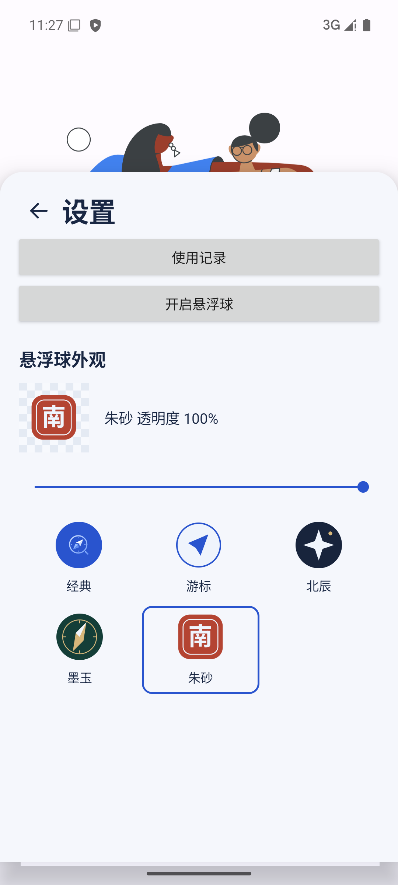
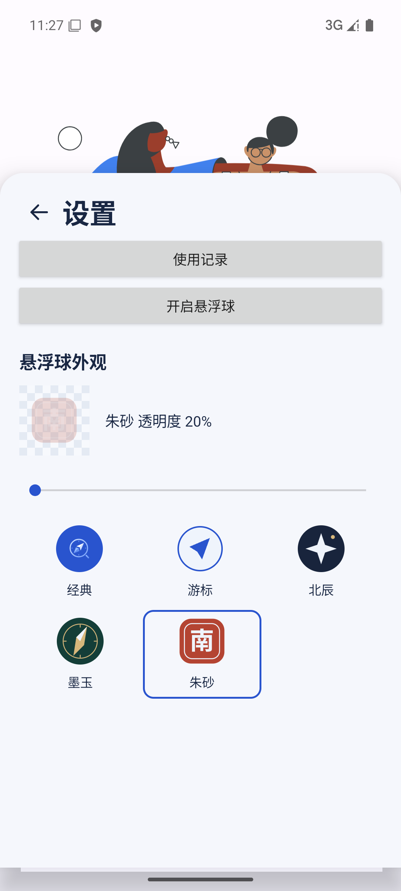
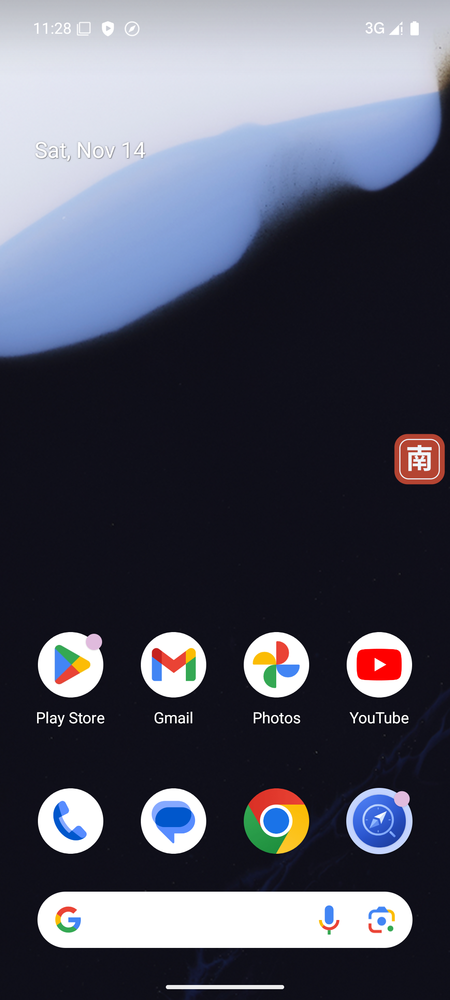
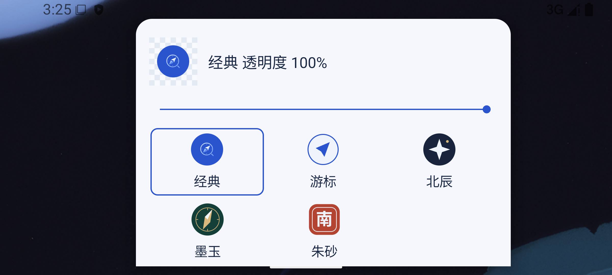

# 悬浮球外观验证（0.6.0-dev）

日期：2026-11-14。设计及保存规则见 [悬浮球外观](ball-appearance.md)。只在指定模拟器操作，未操作连接的真机。

## 构建和检查

```bash
./gradlew :app:assembleDebug :app:lintDebug :core:search:build --offline --console=plain
python3 tools/smoke_ball_android.py --appearance --serial emulator-5554
python3 tools/smoke_ball_android.py --appearance --serial emulator-5556
python3 tools/smoke_android.py --serial emulator-5554
python3 tools/smoke_android.py --serial emulator-5556
```

Debug 构建通过，Lint 0 项，纯 JVM 模块原有 24 项测试失败/错误均为 0。新功能位于 Android 适配层，没有修改 T9 和排序模型。

接续原会话时核对了以上双版本专项和入口回归的实际命令输出，并重新执行构建、Lint、搜索模块构建及 API 29 / 35 外观完整专项，均通过。

## 外观专项

Pixel 7 API 35 和 android10test API 29 均通过：

- 默认经典款、100%；五款可逐一选择，单选状态正确；未开启球时选择不启动服务。
- 滑块可达到 20% 和 100%，预览与百分比同步更新。
- 选择墨玉并设约 60%，结束进程后重新打开仍保留样式与百分比，球仍默认关闭。
- 手动开启后读取真实窗口 alpha，与保存值一致。
- 运行中切换北辰并调至 20%，服务不重启，收起面板后窗口 alpha 为 0.2；该状态仍能点击打开面板，再切换朱砂并恢复 100%。
- 原有点击/面板互斥、拖动贴边、跨进程位置记忆、关闭、不自启、锁屏/旋转、通知关闭和悬浮权限撤销清理继续通过。API 35 另覆盖按需通知授权的拒绝和再次允许。

脚本备份位置与外观的 XML 及备份文件，仅在应用私有目录保存；运行时使用固定外观数据，结束后还原，不输出原配置内容。开始前必须关闭球，异常中断留下备份时拒绝覆盖。使用汇总不参与外观专项；原有入口脚本仍按既有机制恢复使用汇总。

## 视觉检查

人工检查实际截图，五款在图形上有区别，选中边框清晰；透明度仅作用于预览球/实际窗口，样式选项与文字保持清晰。没有新增自动动画或位图皮肤。

补测 API 35 的 150% 字号竖屏及横屏：从模拟器桌面打开面板，进入设置并滚动到底部，五款图形和名称均可访问；横屏实际显示尺寸为 2400×1080。测试结束后恢复字体、旋转设置和窗口旋转模式。测试脚本的滚动定位限定为本应用，滑动避开系统手势边缘，防止误操作下层桌面。






## 边界

最低 API 26、API 36、厂商真机和完整 TalkBack 流程尚未验证。低透明度在不同壁纸上的可辨识程度会变化，未宣称低透明状态满足所有对比度标准；控件仍保留固定 48dp 触摸区域。

SharedPreferences 为后台异步保存，不承诺设备突然断电时最后一次调整一定写入。未知样式/非法值的回退由适配层实现，本轮未手工注入损坏的偏好文件。未增加权限、外观行为日志或使用统计字段。
