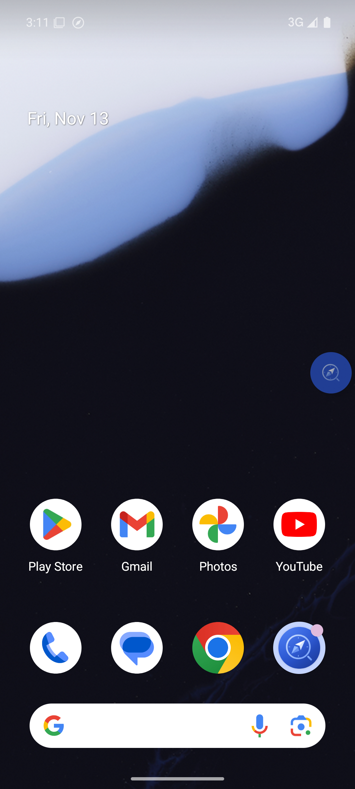
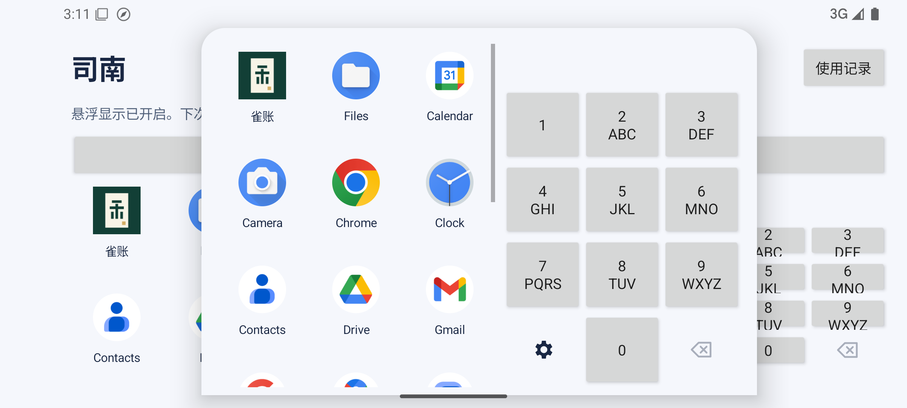
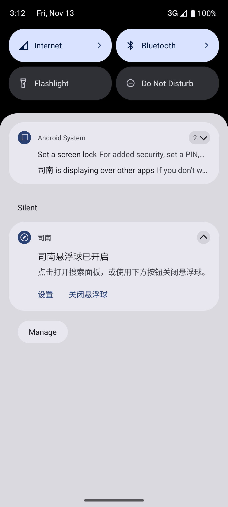
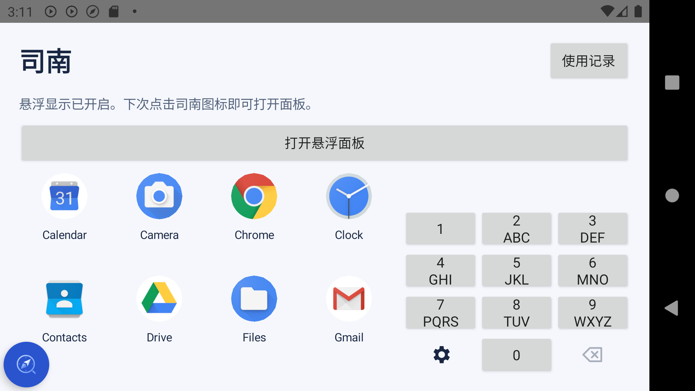

# 悬浮球验证（0.5.0-dev）

日期：2026-11-13。功能及平台依据见 [悬浮球](floating-ball.md)。未接入系统使用情况统计、网络、分析 SDK 或无障碍服务。

## 构建与回归

```bash
./gradlew :core:search:build :app:assembleDebug :app:lintDebug --offline --console=plain
python3 tools/smoke_ball_android.py --serial emulator-5554
python3 tools/smoke_ball_android.py --serial emulator-5556
python3 tools/smoke_android.py --serial emulator-5554
python3 tools/smoke_android.py --serial emulator-5556
```

构建通过，Lint 0 项，纯 JVM 模块共 24 项测试，失败/错误为 0；两版本悬浮球专项和原有入口完整回归均通过。

设备为 Pixel 7 API 35 和 android10test API 29。所有脚本只接受模拟器，不在用户真机上操作。

## 悬浮球专项

两版本通过：

- 默认关闭，普通启动没有球服务；前台设置手动开启后只有一个球，跨应用保留，服务状态为 foreground 并注册通知 ID 1001。
- 点击球打开一个面板，球移除；返回关闭面板后球恢复。
- 超过 touch slop 的拖动不触发打开，松手贴边；设置关闭后服务/窗口释放，再开启保留位置。
- 进程结束后窗口和服务清理，重新打开司南不擅自开启；手动再次开启仍保留贴边方向和高度。
- 屏幕休眠/非安全锁屏时球隐藏、服务保留；唤醒并解锁后恢复。
- 横屏后球约束在显示边界内；测试返回竖屏再检查通知操作，避免通知操作区域被横屏下的系统通知挤出屏幕。
- 通知「关闭悬浮球」可停止球与服务。
- 撤销悬浮权限后清理窗口/服务，恢复权限后仍需手动开启。

API 35 另通过通知运行时权限的拒绝与再次授权：拒绝不启动球/服务，允许后正常启动。真实进程终止使用应用调试身份发送 SIGKILL，等待后无自动拉起；API 29 的调试域拒绝该命令，改用 `am force-stop`，不声称该镜像验证了相同的 SIGKILL 路径。

原有 `smoke_android.py` 用于检查搜索、九宫格、常用排序持久化/清空/损坏恢复、重复面板、返回/外点/Home、快捷设置磁贴和权限降级。专项结束后再执行，检查默认未启用球时原入口仍独立工作。

## 测试环境处理

专项脚本将原球位置文件备份在应用私有目录；不读取使用汇总，也不把位置内容输出到电脑。结束时关闭球，恢复原位置、悬浮权限、通知授权及 user-set/user-fixed 标记、旋转配置。遗留备份目录时拒绝覆盖，需要先检查并恢复后再运行。

Android 15 系统设置中的部分页面主动隐藏第三方 Overlay；这不是球服务退出。旋转在司南普通页面进行，不绕过系统的安全隐藏行为。Android 10 用窗口管理器旋转命令同步锁定方向，避免直接写设置后尚未完成旋转就断言横屏坐标。

## 截图

API 35：桌面上的球、点击后的面板（球隐藏）、通知关闭入口。





API 29 横屏位置：



## 边界

最低 API 26、API 36、厂商真机、密码/生物识别锁屏、TalkBack、折叠屏、长时间待机及分发审核尚未完成。频道被阻止的广播处理已实现，专项主要验证通知初次拒绝和通知关闭动作，未模拟全部厂商的通知设置页面。

NOT_STICKY 不等于平台永不创建新进程；本应用没有重新开启功能的后台调度。应用/设备被强制结束后需用户手动开启；位置记忆不代表自动恢复服务。
