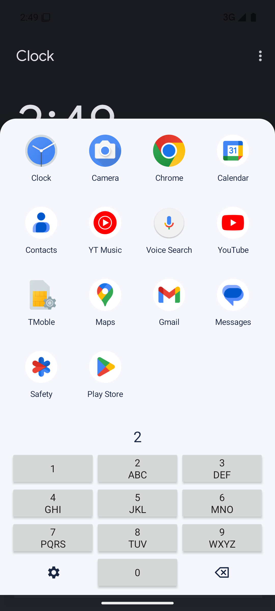
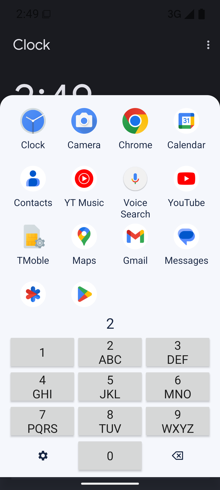
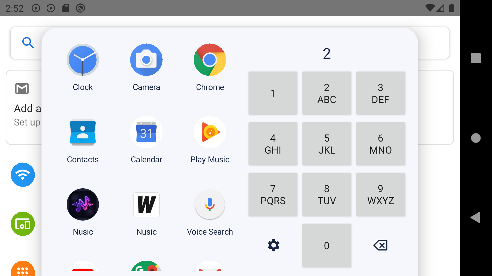

# 面板简化验证

日期：2026-11-13。按用户截图移除悬浮面板顶部的标题、设置/关闭按钮、输入提示和应用数量。输入数字位于键盘上方，底行改为设置图标 / 0 / 退格图标，短按退格、长按清空。

## 验证结果

- `:app:assembleDebug :app:lintDebug --offline` 通过，Lint 无问题。未修改匹配/排序算法。
- API 35 与 API 29 完整模拟器回归通过：T9、0/1、短按退格、长按清空、无结果、快速改输、启动收起、返回/外点/Home、磁贴、权限降级、统计保存及清空恢复。
- 回归脚本已适配图标的无障碍描述，并增加数字栏/网格/键盘的位置断言、图标类型检查和顶部控件移除检查；镜像要求英文 Clock 和名称首项 Calendar。
- 最终安装包额外检查 API 35 普通字体及 1.5 倍字体：顶部控件移除，数字栏不与网格和按键重叠，两个功能按钮为图标，短按/长按行为正确，设置图标可进入普通页面及其设置菜单。
- 最终安装包额外在 API 29 固定横屏、于已横屏的系统设置上唤出面板，验证数字栏位于右侧键盘上方、与左侧网格不重叠，以及短按/长按、设置入口；随后恢复原旋转设置。
- 设置图标在空查询时可用；退格空查询时禁用。无结果与加载失败仍有必要反馈，正常网格不显示数量或输入提示。

竖屏数字栏在网格下方、键盘上方。横屏保持左右布局，数字栏随键盘位于右侧上方。空输入保留固定高度的空白数字栏，避免输入时移动键盘与网格。透明面板宿主沿用底层应用的方向；桌面锁定竖屏时不会仅因修改旋转设置强制横屏。

## 截图





## 复验

```bash
./gradlew :app:assembleDebug :app:lintDebug --offline --console=plain
python3 tools/smoke_android.py --serial emulator-5554
python3 tools/smoke_android.py --serial emulator-5556
```

旧验证文档截图保留其当时版本，不代表当前布局。真机、最低版本、API 36 和 TalkBack 专项验证仍待补充。
