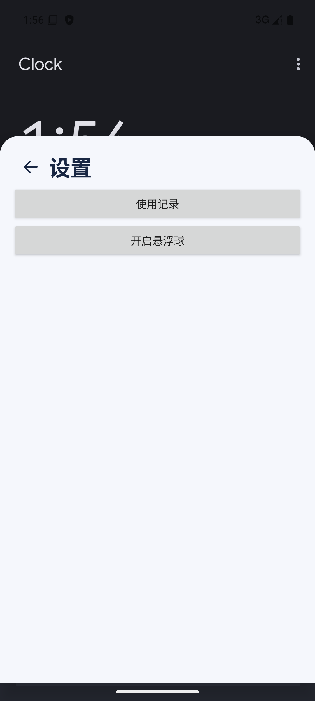
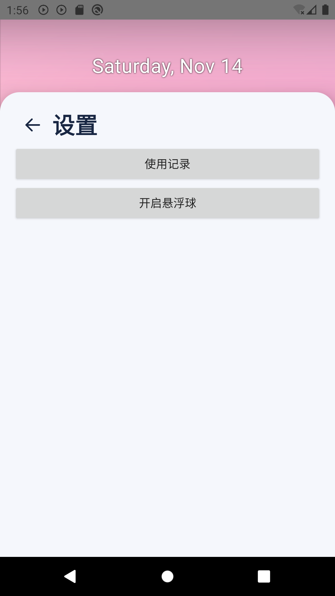

# 面板内设置验证

设置改为同一悬浮窗口内的第二页，提供返回搜索图标、使用记录与悬浮球开关。普通 Activity 降级页保留；通知设置动作直接打开面板设置页。

## 验证范围

- Debug 构建、Lint 与搜索模块构建通过；Lint 0 项，原 24 项 JVM 测试失败/错误均为 0。
- API 29 / 35 原有完整入口回归通过，新增断言：打开设置后仍有同一个面板，返回搜索保留输入查询；返回图标和系统返回可分别操作。
- API 29 / 35 通过面板内设置执行悬浮球完整回归，包括开启/关闭、通知权限拒绝与允许（API 35）、拖动位置、进程结束、锁屏/旋转、通知关闭、撤销悬浮权限。
- 补充检查网格滚动后切设置再返回，比较可见应用与其边界；查询非空时返回结果保持不变。使用记录确认窗关闭后留在设置页，再返回搜索。未清空真实使用记录。API 29 额外确认在当前设置页开启球后按钮立即更新为关闭，再直接关闭。

## 复验

```bash
./gradlew :app:assembleDebug :app:lintDebug :core:search:build --offline --console=plain
python3 tools/smoke_android.py --serial emulator-5554
python3 tools/smoke_android.py --serial emulator-5556
python3 tools/smoke_ball_android.py --panel-settings --serial emulator-5554
python3 tools/smoke_ball_android.py --panel-settings --serial emulator-5556
```

脚本只操作模拟器，保留既有权限/位置/使用汇总恢复机制。原无参数悬浮球脚本仍可验证普通降级页入口。默认排序回归改为比较清空前后冷启动顺序，不假设镜像固定以 Calendar 为第一项。返回分发统一先关闭最上层确认窗，再退出设置，覆盖 Android 15 Overlay 确认窗的返回路由。

## 实现边界

页面切换只改变两个 View 的可见性，不拆除网格或重新构建会话。显式清空统计会刷新排序，属于主动数据操作。旋转重建保存当前页面标记，尚未承诺跨 Activity 重建保留完整搜索/滚动状态。

系统通知权限和系统通知设置属于系统 UI：临时隐藏面板，返回后显示原设置页。确认弹窗按宿主使用对应窗口类型；外部点击、Home 或关闭宿主仍释放面板及确认窗。未增加权限、后台行为或采集字段。

## 截图



