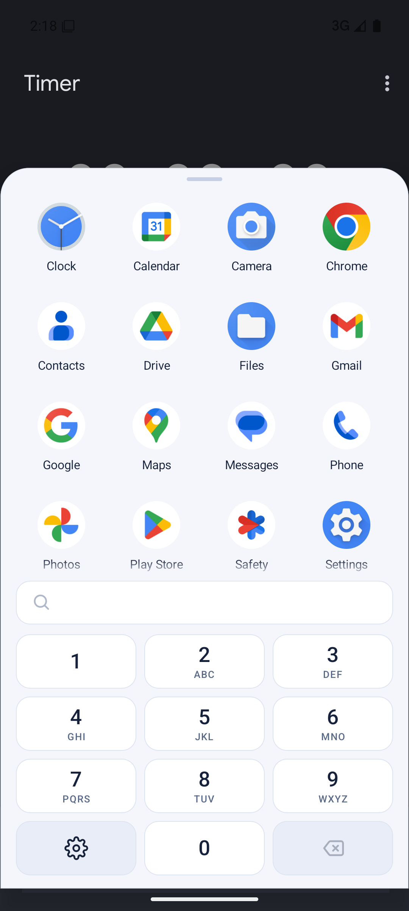
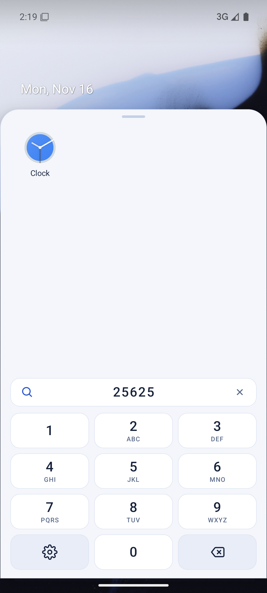
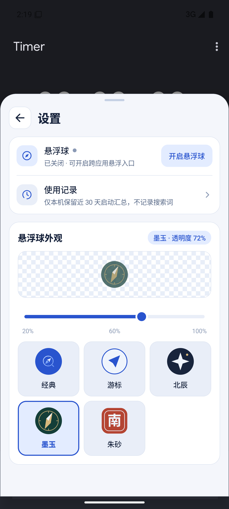
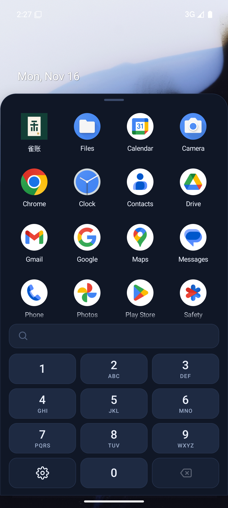
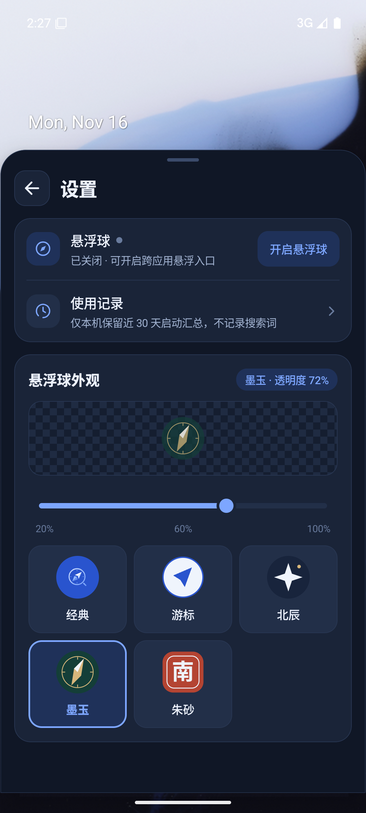
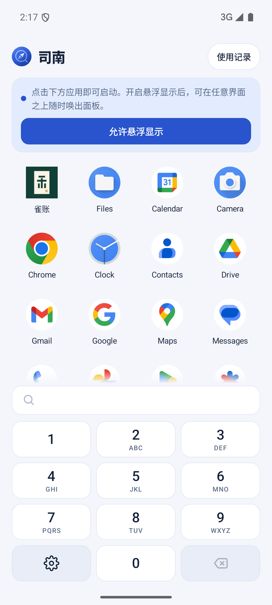
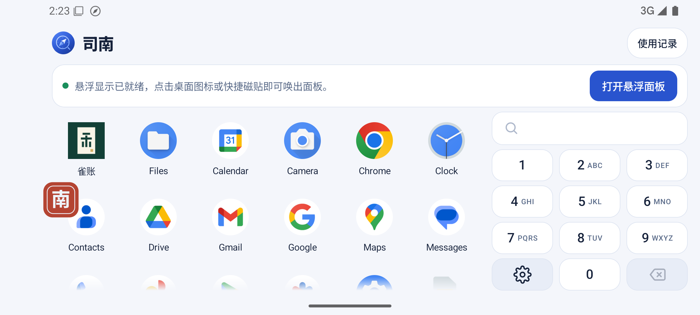
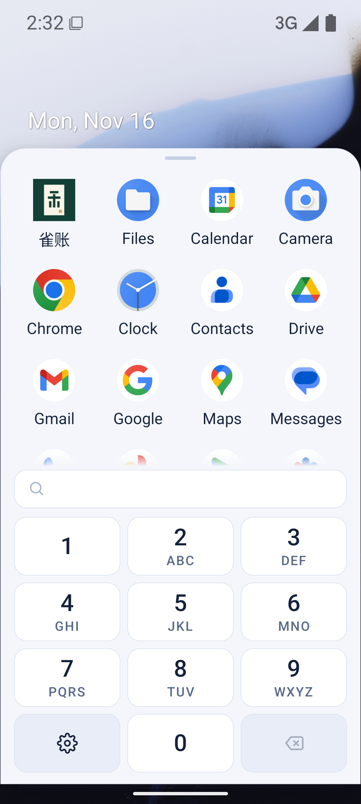

# UI 视觉重构验证记录

日期：2026-11-16。依据用户确认的「司南品牌现代极简风」及全界面统一重构范围，在不引入 Compose / AndroidX / 第三方依赖的前提下，使用纯原生 View、Drawable 与属性动画重构全部页面与交互细节。

## 设计与实现范围

- **色彩与表面分层**（`values/colors.xml`、`values-night/colors.xml`、`SinanUi.kt`）：
  - 建立浅色（纸白 `#F4F6FB`、卡片白 `#FFFFFF`、轻蓝灰 `#E9EEF8`、司南靛蓝 `#2954CE`）与深色（夜墨 `#101726`、卡片 `#1A2438`、按键 `#1E2A42`、提亮靛蓝 `#7DA6FF`）分层色板。
  - 新增 `Theme.Sinan.Dialog`（20dp 圆角卡片弹窗）与 `panel_background.xml`（28dp 顶圆角 + 1dp 细腻描边），补充 `values-v27` / `values-night-v27` 浅深色导航栏图标适配。
- **悬浮面板与网格**（`PanelActivity.kt`、`AppGridView.kt`）：
  - 在极简结构基础上于面板顶部增加 36dp×4dp 轻量指示条（支持点击收起），并接入 `WindowInsets` 适配底部手势导航与刘海安全区。
  - 网格单元采用圆角 16dp 涟漪反馈、顶部/底部 18dp 垂直渐隐边缘、居中状态容器（无匹配/加载/失败重试胶囊）。
  - 数字栏升级为 14dp 圆角胶囊条：左侧搜索微光图标、居中大号等宽数字（`tnum`）、右侧在有输入时显示一键清空按钮（无输入时保持空白并占位居中）。
  - 搜索页与设置页切换使用 90ms 轻量淡入（遵循系统动画开关）。
- **内置 T9 键盘**（`T9KeyboardView.kt`）：
  - 数字与字母字号、字重、颜色层级分离（21sp Medium 数字 + 10sp 次级字母），圆角 14dp 独立按键卡片，按压微缩与 `KEYBOARD_TAP` / `LONG_PRESS` 触感反馈。
  - 底行「设置图标 / 0 / 退格图标」保持等高卡片对称布局。
  - 矮屏/横屏可用行高不足时自动切换为「左数字右字母」并排居中排版，防止字母副标被裁切。
- **设置页、外观与降级主页**（`SettingsPage.kt`、`BallAppearanceView.kt`、`SettingsActions.kt`、`MainActivity.kt`）：
  - 设置页分组卡片化：显式呈现悬浮球运行状态圆点、说明副标题与开关按钮，使用记录列表行配右箭头引导；确认弹窗危险动作采用朱砂红强调。
  - 悬浮球外观卡片右上角展示当前样式与透明度胶囊，预览舞台使用自适应深浅色的圆角裁切棋盘格，定制圆角滑块轨与 `20% / 60% / 100%` 刻度，选中样式卡片带靛蓝填充与边框。
  - `MainActivity` 增加品牌圆角徽标与胶囊按钮；横屏时引导卡片自动切换为横向单行，为下方网格与 T9 键盘让出充足高度。

## 构建与回归结果

在工作区及 Android 15（API 35）模拟器 `emulator-5554` 执行验证（未连接或操作真机，API 29 模拟器本轮未复验）：

- `./gradlew :app:assembleDebug :app:lintDebug :core:search:build --no-daemon --offline --console=plain`：全部通过；Android Lint 报告 `No errors or warnings`（0 错误、0 警告）；`:core:search` 既有纯 JVM 测试无改动且通过。
- `python3 tools/smoke_android.py --serial emulator-5554 --adb ~/Library/Android/sdk/platform-tools/adb`：全部通过（无权限降级、T9 过滤、0/1、短按退格/长按清空、无结果、常用学习/清空/损坏恢复、快捷磁贴、面板内设置及返回保留查询、撤权降级）。
- `python3 tools/smoke_ball_android.py --appearance --serial emulator-5554 --adb ~/Library/Android/sdk/platform-tools/adb`：全部通过（五款样式、20%–100% 透明度预览与持久化、按需通知授权、运行中切换、拖动贴边、被杀不自启、锁屏与横屏边界、通知关闭、撤权清理）。
- 人工视觉复查 API 35 浅色/深色面板、设置与外观页、主引导页、1.5 倍大字号与横屏并排键盘截图，布局整齐无截断、无重叠，手势栏安全区预留充足。

## 实测截图（API 35）

## 剩余待验证项

- API 26 最低支持版本、API 29、API 36 与厂商真机兼容性验证。
- 完整 TalkBack 无障碍逐项朗读走查。
