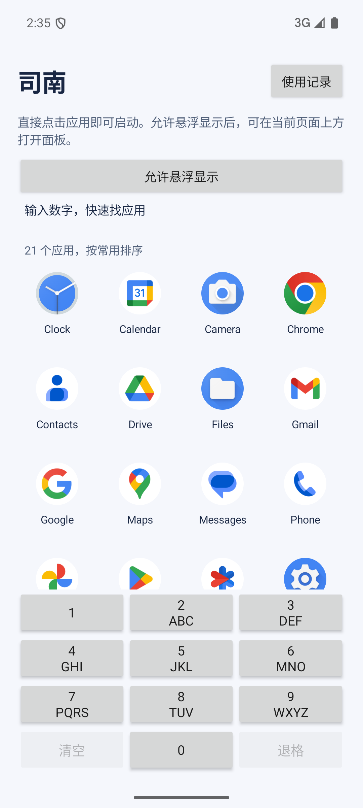
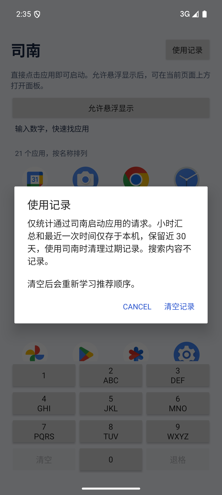
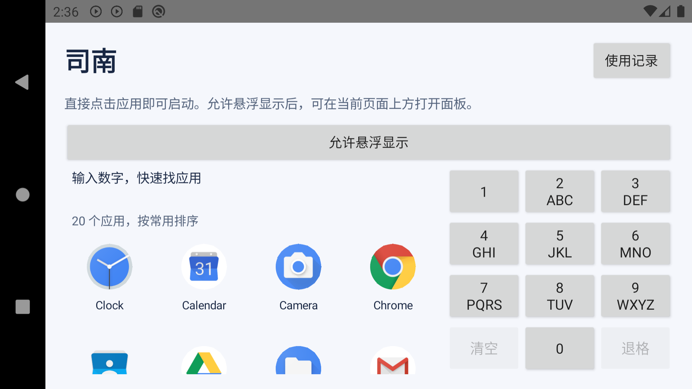
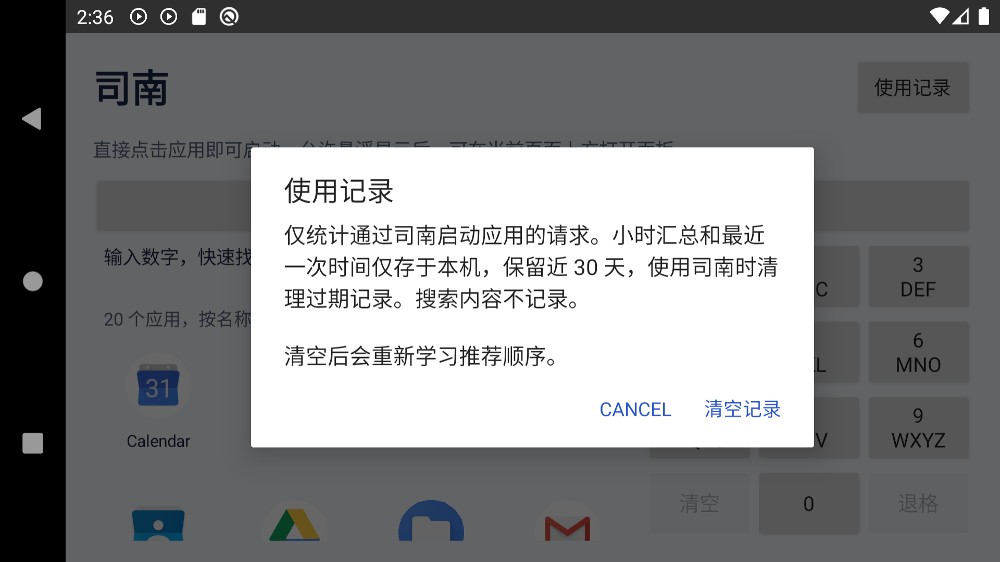

# 本地智能排序验证（0.4.0-dev）

日期：2026-11-13。统计范围和算法见 [本地智能排序](usage-ranking.md)。所有排序样例使用固定数据或模拟器默认 Clock 应用，不使用真实个人记录作为断言。

## 构建与引擎

```bash
./gradlew :core:search:test :app:assembleDebug :app:lintDebug --offline --console=plain
```

实际环境使用 Android Studio 内置 JBR。构建通过，Lint 0 项；搜索模块共 24 项 JUnit 测试（原 T9 12 项、使用统计 12 项），失败与错误均为 0。

使用统计测试覆盖：小时聚合、最新时间、30 天淘汰、时钟回拨、快照隔离、幂等恢复、冷启动与同分、频率/最近/长期信号、时段阈值、不可见入口过滤、UTC 与夏令时、profile 分离、真实常用分数不能跨匹配等级、损坏/截断/未知版本/超限/重复 ID、容量及编码顺序确定性。

## 设备回归

镜像为 Pixel 7 API 35（Android 15，竖屏）和 android10test API 29（Android 10，横屏），两套完整回归均通过。以下通过 `tools/smoke_android.py` 执行：

- 无悬浮权限的普通网格、权限引导并返回。
- 清空后名称排序；通过 T9 打开 Clock 后，默认网格首项变为 Clock。
- 汇总文件存在，强制停止后重启仍保留排序。
- 清空后恢复冷启动顺序且主文件/备份/临时文件均不存在。
- 注入固定损坏文件，普通网格回退名称排序；清空后重新启动 Clock，恢复学习。
- T9 过滤、0/1、短按退格、长按清空、无结果和快速改输。
- 唯一悬浮窗、重复唤出、返回/外部点击/Home 释放、搜索启动后收起。
- 快捷设置磁贴、面板设置入口、撤销权限后降级。

复验：

```bash
python3 tools/smoke_android.py --serial emulator-5554
python3 tools/smoke_android.py --serial emulator-5556
```

脚本只接受模拟器，在应用私有目录备份原使用汇总，不输出其内容；结束时恢复原汇总、悬浮权限和磁贴。异常中断留下备份目录时拒绝覆盖，需检查并恢复后再运行。截图使用临时学习的测试数据，随后恢复原记录。

Android 10 上 `test` 为 shell 内建，文件存在检查通过 `run-as … sh -c` 执行；不能直接 `run-as … test`。从普通设置页验证桌面授权路由前先停止应用，再启动新入口。

额外在 API 35 将系统字体临时调至 1.5 倍，确认普通页的 12 个按键和「使用记录」入口均可见，并检查截图无文字裁切；随后恢复原字体设置。

## 截图

API 35：学习后的默认网格与本地记录说明。




API 29 横屏：学习后的网格、键盘和记录说明。




## 验证边界

模拟器验证的是工具内请求学习及持久化闭环，不代表实际前台使用或全局常用排名。30 天滚动通过固定时钟 JVM 测试验证，没有等待实际 30 天。未知版本、截断及容量限制由模型测试覆盖，未在设备制造磁盘写满或进程恰在写入中被杀的故障。

最低 API 26、API 36、厂商真机、TalkBack、跨资料与长期使用效果仍未完成。没有采集真实习惯样本或证明首屏命中率改善，评分权重仍为初始值。
